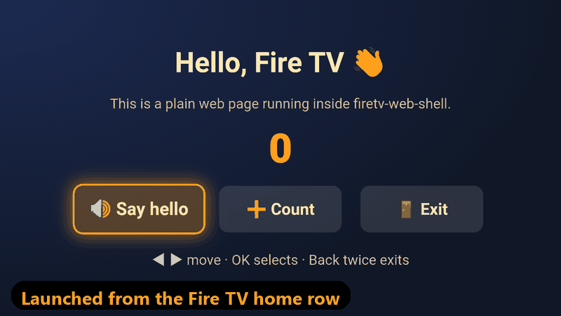

# firetv-web-shell

**Ship any web app to Fire TV in 5 minutes.** A tiny Kotlin WebView shell plus dependency-free D-pad focus helpers, extracted from [NaniTV](https://github.com/sarthak115/nanitv) (built for the Amazon "Build, Ship, Shape" hackathon, Fire TV track).



You keep building a normal web app (React, Vue, plain HTML, anything). The shell gives it a Fire TV home-row banner, full-screen display, the remote's Back key, native text-to-speech and live reload from your laptop. The `web/` helpers make every screen usable with just ◀ ▶ ▲ ▼, OK and Back.

## What's inside

| Path | What |
|---|---|
| `android/` | Kotlin, single Activity, fullscreen WebView. `minSdk 22` (Fire OS 5+), `targetSdk 35`. ~250 lines. |
| `web/focus.ts` | Framework-free D-pad focus: `createFocusGroup(container, { onSelect })` |
| `web/useFocusGroup.ts` | The same as a React hook: `const { bind } = useFocusGroup(['a','b','c'], { onSelect })` |
| `web/native.ts` | Typed wrapper for the shell bridge (`speak`, `onBack`, `exitApp`, …) with browser fallbacks |
| `web/dist/` | Pre-built JS + `.d.ts` of the above (no build step needed to try it) |
| `example/` | A no-build demo page: three focusable buttons, TTS, double-Back-to-exit |
| `tools/` | `serve.mjs` (zero-dependency LAN server), `make-banner.ps1` (banner/icon generator) |

**Shell features**
- `LEANBACK_LAUNCHER` intent filter + 320×180 banner, so the app appears in *Your Apps & Channels*.
- Fullscreen and immersive; keeps the screen on.
- **Back key → JavaScript.** Back never reaches a WebView page by default. The shell fires `window` event `tvshell-back` and your page decides (go back, or `TvShell.exitApp()`).
- **Select → Enter.** D-pad arrows arrive as `ArrowUp/Down/Left/Right`; OK/Select arrives as `Enter` (explicitly remapped as a safety net).
- **`window.TvShell` bridge:** `speak(text, lang)`, `stopSpeaking()`, `ttsLanguages()`, `exitApp()`. Includes a fallback for older sticks whose default TTS engine refuses third-party apps (see [Fire TV notes](#fire-tv-notes)).
- **Debug builds** load your laptop's dev server over LAN (cleartext allowed in debug only). `chrome://inspect` works, the page console is mirrored to `adb logcat -s TvShell`, and `--es url …` overrides the URL per launch.
- **Release builds** load your HTTPS URL; cleartext is disabled.
- Autoplay allowed (`mediaPlaybackRequiresUserGesture = false`): there's no "tap" on a TV.

## 5-minute quickstart

You need: a Fire TV with **ADB debugging** on, a computer on the same Wi-Fi with **Android Studio** (or the Android SDK + JDK 17) and **Node 18+**.

**1. Enable ADB on the Fire TV.** Go to *Settings → My Fire TV → Developer Options → ADB debugging: ON*. If Developer Options is missing, open *Settings → My Fire TV → About* and press OK on the device name 7 times. Note the IP under *About → Network*.

**2. Clone and serve the example**
```bash
git clone https://github.com/sarthak115/firetv-web-shell
cd firetv-web-shell
node tools/serve.mjs
```
It prints a URL like `http://192.168.1.10:3000/example/`. Open it on your computer first: arrow keys + Enter act as the remote, and Esc acts as Back. On Windows, allow Node through the firewall for **private** networks.

**3. Point the shell at it**
```bash
cd android
cp local.properties.example local.properties    # Windows: copy local.properties.example local.properties
```
Edit `local.properties`: set `sdk.dir` (Android Studio fills it in if you open the `android/` folder) and `shell.devUrl` to the URL from step 2.

**4. Build, install, launch**
```bash
adb connect <FIRE_TV_IP>:5555        # first time: accept the prompt ON THE TV
./gradlew assembleDebug              # Windows PowerShell: .\gradlew.bat assembleDebug
adb install -r app/build/outputs/apk/debug/app-debug.apk
adb shell am start -n dev.firetvwebshell.demo/dev.firetvwebshell.MainActivity
```
The example appears on the TV. Use the remote: ◀ ▶ moves the glowing focus, OK presses, Back twice exits. "Say hello" speaks through the TV.

**5. Make it yours.** Point `shell.devUrl` at your own dev server, e.g. Vite at `http://<LAN-IP>:5173/` (run `vite --host`). With Vite's HMR, saving a file live-reloads on the TV. Then set:
```properties
shell.appId=com.yourname.yourapp
shell.appName=Your App
shell.releaseUrl=https://your-app.example.com/
```
Run `powershell -ExecutionPolicy Bypass -File tools/make-banner.ps1 -Title "Your App"` (or drop in your own `banner.png`/`icon.png`), then `./gradlew assembleRelease` for an APK that loads your hosted site.

## Using the web helpers

Copy the files from `web/` (or `web/dist/`) into your project. They have no dependencies; `useFocusGroup` needs React.

**Plain JS / any framework**
```html
<div id="menu">
  <button data-focus="play">Play</button>
  <button data-focus="settings">Settings</button>
</div>
<script type="module">
  import { createFocusGroup } from './focus.js';
  import { onBack, exitApp, speak } from './native.js';

  createFocusGroup(document.getElementById('menu'), {
    layout: 'row', // 'column' or 'both'
    onSelect: (id) => (id === 'play' ? speak('Playing!') : openSettings()),
  });
  onBack(() => exitApp());
</script>
<style>
  /* Style data-focused, not :focus: the ring must never disappear. */
  [data-focused='true'] { outline: 6px solid #ff9f1c; transform: scale(1.08); }
</style>
```

**React**
```tsx
import { useFocusGroup } from './useFocusGroup';

function Home({ onOk, onMessages, onHelp }) {
  const { bind } = useFocusGroup(['ok', 'msgs', 'help'], {
    onSelect: (id) => ({ ok: onOk, msgs: onMessages, help: onHelp })[id](),
  });
  return (
    <>
      <button {...bind('ok')}>I'm OK</button>
      <button {...bind('msgs')}>Messages</button>
      <button {...bind('help')}>Need help</button>
    </>
  );
}
```
One focus group per screen keeps navigation predictable. Pass `enabled: false` to a group while another screen or dialog owns the keys.

### TV design tips that worked for us
- Design on a fixed **1920×1080** stage and `transform: scale()` it to the WebView size (often 960×540 CSS px on a stick). Keep 5% padding for overscan. Give `html, body` `overflow: hidden` and measure `document.documentElement.clientWidth`: an overflowing stage makes `innerWidth` report 1920 in the shell's wide-viewport mode.
- **At most 3 focusable buttons per screen**, at least 360×140 px, with text ≥ 48 px if the viewer is 3 m away.
- Make Back always do something sensible, and require **two presses to exit** from your home screen.
- Show the focus with a thick outline + scale + glow, and never let focus disappear.

## Fire TV notes
Learned the hard way on a Fire TV Stick 2nd gen (Fire OS 5, API 22, Amazon WebView 108):
- **TTS:** the default engine `com.ivona.tts.oem` reports **every** locale as unsupported (`-2`) to third-party apps, even `en-US`. The shell detects this and re-initialises with `com.svox.pico` (en-US/en-GB/en-IN). There is no Hindi voice on that device.
- `TextToSpeech.getAvailableLanguages()` throws on Pico there; the bridge probes known locales instead.
- **Back** goes to the Activity, not the page, unless you forward it (done for you).
- **ADB over Wi-Fi** says `unauthorized` until you accept the prompt **on the TV screen**.
- **Mic / `crypto.randomUUID`** need a secure context: plain-HTTP LAN URLs aren't. That matters for phone companion pages, not the TV page.
- Vite: list your deps in `optimizeDeps.include`. A mid-session dependency re-optimisation leaves two React copies in the WebView ("Invalid hook call"), and the TV just shows a blank page. Watch `adb logcat -s TvShell`.
- Third-party apps can't draw over other apps (Netflix/YouTube) on Fire TV, so your app only "talks" while it's open.

## License
[MIT](LICENSE)
